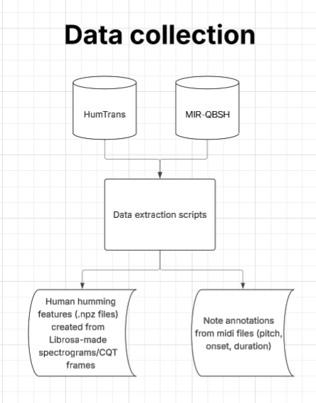
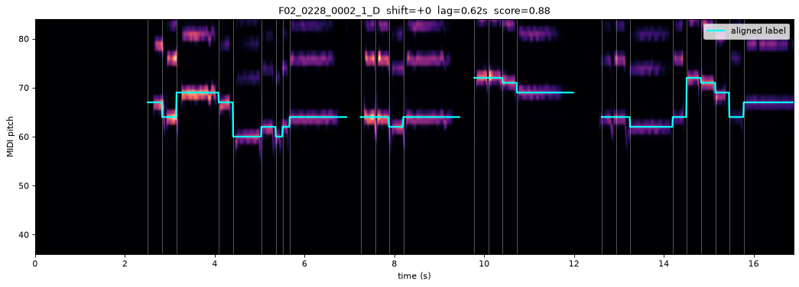
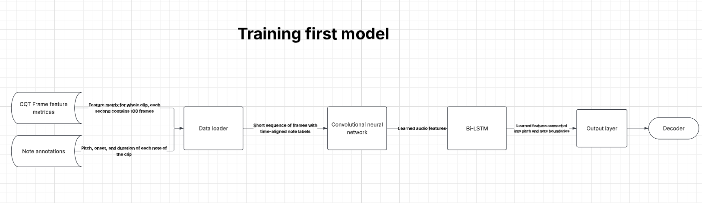
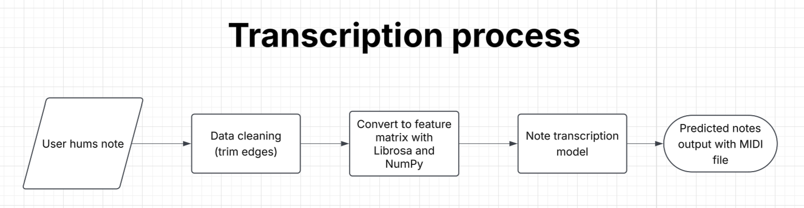

# Hyrule Warriors: Human Humming to Musical Note Transcription
## Introduction
Our team aims to create a deep learning model that can take human humming as an input and transcribe it into notes. We were inspired by the new <i>The Legend of Zelda: Ocarina of Time</i> game which includes a feature allowing the player to hum the notes of a song to activate a certain mechanic: <https://youtu.be/PQvD3p2yGwc?si=BmR2eiGZjW1xTqee&t=793>

We want to make a model that can be used in a similar way so that a user can hum into their microphone and have a transcribed series of notes instantaneously.

## Project status
- [x] Data collection scripts for HumTrans and MIR-QBSH
- [x] Python environment (`requirements.txt`)
- [x] Checked whether HumTrans labels line up with the audio (they need a per-clip octave and lag fix, see [Frame labels](#frame-labels))
- [x] Frame labels (`build_labels.py`), tested on 30 sample clips
- [x] Train / validation / test split (`splits.py`)
- [x] pYIN baseline and evaluation (`baseline_pyin.py`)
- [ ] Fix `collect_HumTrans_wav.py` storage cap and generate features for the full dataset
- [ ] PyTorch dataset and CNN + Bi-LSTM model
- [ ] MIR-QBSH labels from `.pv` pitch files
- [ ] Synthetic hums for pre-training

## Pipeline
Run the scripts from the project folder in this order:

| Step | Command | Output |
|---|---|---|
| 1. MIDI notes | `python collect_HumTrans_midi.py` | `processed_data/HumTrans/midi_notes.csv` |
| 2. Audio features | `python collect_HumTrans_wav.py` | `processed_data/HumTrans/features/<clip>.npz` |
| 3. Frame labels | `python build_labels.py` | `processed_data/HumTrans/labels/<clip>.npz`, `alignment.csv` |
| 4. Check the split | `python splits.py --min-align-score 0.6` | clip counts (nothing written) |
| 5. Baseline | `python baseline_pyin.py --n 100` | `results/baseline_pyin.csv` |

Step 5 streams its own audio, so it does not need steps 2-3.

## Required dependencies
All packages are listed in `requirements.txt`. Install them into a virtual environment from the project folder:
```
python3 -m venv .venv
source .venv/bin/activate
pip install -r requirements.txt
```

* huggingface_hub, remotezip (downloading HumTrans)
* pretty_midi (reading MIDI files)
* librosa (spectrograms, CQT and pYIN pitch tracking)
* numpy, scipy, matplotlib (math and plots)
* torch (the model)
* mir_eval (scoring transcriptions)


## Data Collection



### HumTrans
In `./raw_data/HumTrans/test/` is `extraction.ipynb`. This is a sample notebook that shows the process of downloading humming `.wav` files and their associated MIDI files. There are also two example files `one_hum.wav` and `one_midi.mid`.

`collect_HumTrans_midi.py` converts the MIDI files stored in `raw_data/HumTrans/all_midi.zip` into a CSV which splits up each individual note of the song and stores the file it is from, the pitch, the pitch name (what note it is), the onset, and the duration. `collect_HumTrans_wav.py` converts the human humming samples from the HumTrans API into features stored in `.npz` files that we can feed to our neural network later on. Each `.npz` holds `log_mel_db` (128 mel bands), `cqt_log_magnitude` (84 bins, one per semitone from C1) and `frame_times_s`, at 100 frames per second.

**Note:** `collect_HumTrans_wav.py` currently stops once its output reaches `MAX_OUTPUT_GB` (set to 0.013, about 13 MB, which is only a few dozen clips). Raise it before generating the full dataset.

HumTrans has 14,614 clips from 10 singers (F01-F05, M01-M05). Files are named `personID_musicID_segmentID_repetitionID`, sometimes followed by `_U`, `_D`, `_DD` or `_DDD`, e.g. `F04_0055_0001_2_DD`. The dataset is licensed CC BY-NC 4.0 (non-commercial use only).

### MIR-QBSH
This is a zip file (`raw_data/MIR-QBSH/MIR-QBSH.zip`) containing human singing and the MIDI files associated with them. There are roughly 50 songs used in this data set and a handful of people singing the songs. `collect_MIR_QBSH_midi.py` and `collect_MIR_QBSH_wav.py` process the data the same way the scripts used for HumTrans do. 

The zip file is not in the repo to save space. To download it, go to <http://mirlab.org/dataset/public/> and store it in the `raw_data/MIR-QBSH/` folder.

**Note (not yet checked on our copy):** the MIR-QBSH MIDI files are the original song melodies, not transcriptions of each recording. People sang in their own key and tempo, so we expect the MIDI note times not to line up with the audio. The dataset also includes `.pv` pitch-vector files with labelled pitch for each recording, which are a better candidate for labels. We need to confirm both once the zip is downloaded.

### Hum Generation
In `./raw_data/Librosa/test/` is `librosa_hum_demo.ipynb`, a demo program showcasing how we can use NumPy and SciPy to generate audio waves. From those audio waves, we can use Librosa to create a spectrogram representation of that audio wave to feed our model. There is also a sound file created at the end so we can hear what the generated hum sounds like.


## Frame labels
The model predicts one output per CQT frame (100 frames per second), so the MIDI notes have to be turned into per-frame labels. `build_labels.py` does this for every `.npz` in `processed_data/HumTrans/features/` and saves the labels to `processed_data/HumTrans/labels/<clip>.npz`:

* `pitch`: MIDI note number for each frame (0 = silence)
* `onset` / `offset`: 1 on the frame where a note starts / ends
* `octave_shift`, `lag_s`, `align_score`: the alignment used for this clip (see below)

It also writes `processed_data/HumTrans/alignment.csv`, one row per clip.

### Why the labels need aligning
We tracked the hummed pitch with pYIN on 30 clips (3 per singer), compared it with the MIDI, and found two problems:

* **Octave:** female singers hum at the MIDI octave, but male singers are usually 12 semitones lower, and sometimes 0 or +12. The `_D`/`_DD` file name suffix does not tell you which.
* **Lag:** singers start each note late by a fixed amount per clip, usually 40-250 ms but up to ~1 s for singers F02 and M02. It does not drift within a clip.

In the pYIN check, fixing both raised the share of frames within half a semitone of the label from about 0.5 to 0.8-0.9 for most clips. Singer M02 stayed around 0.55 even after the fix.

`build_labels.py` estimates both for each clip from the CQT, so it does not need the audio: it picks the octave shift and lag that put the most hummed frames within half a semitone of the label, and saves that fraction as `align_score`. On the same 30 clips it chose the same octave shift as pYIN every time, and its lag was within about 50 ms. Its `align_score` is somewhat lower than the pYIN figure for low male voices (0.35-0.87 for the male clips, 0.73-1.00 for the female clips), so the training cut-off (0.6 for now) should be tuned once every clip has a score.

To check a clip by eye:
```
python build_labels.py --plot F02_0228_0002_1_D
```


The cyan line is the aligned label drawn over the CQT. This clip needed a 0.62 s lag correction.

## Train / validation / test split
`splits.py` uses the official HumTrans split (`raw_data/HumTrans/train_valid_test_keys.json`, downloaded from the [HumTrans Hugging Face page](https://huggingface.co/datasets/dadinghh2/HumTrans)): 13080 train, 765 validation and 769 test clips. It is split by **song**, so no song appears in more than one split, but every singer appears in all three. This means test scores show how well the model handles melodies it has never heard, not new voices.

```
python splits.py                        # clip counts per split
python splits.py --min-align-score 0.6  # counts after dropping poorly aligned clips
```
In code: `splits.get_split("train", min_align_score=0.6)` returns the clip names.

## Baseline
`baseline_pyin.py` is a transcriber with no deep learning. It tracks pitch with librosa's pYIN, rounds each frame to the nearest semitone, and groups runs of the same note (at least 60 ms long) into notes. It streams random test-split clips from HumTrans and scores them against the aligned labels using [mir_eval](https://craffel.github.io/mir_eval/). The reference notes are aligned with the same `build_labels.py` functions as the training labels, so every model is scored the same way. Our model needs to beat these numbers.

```
python baseline_pyin.py --n 100
```

| Metric | Meaning |
|---|---|
| COn F1 | note start within 50 ms |
| COnP F1 | note start within 50 ms **and** correct pitch (within 50 cents) |
| COnPOff F1 | as COnP, and the note end is also close |
| frame_acc | fraction of labelled frames with exactly the right MIDI pitch |

Results on 100 random test clips (`--n 100 --seed 0`):

| Metric | All 100 clips | 72 clips with align_score >= 0.6 |
|---|---|---|
| COn F1 | 0.509 | 0.553 |
| COnP F1 | 0.368 | 0.434 |
| COnPOff F1 | 0.251 | 0.318 |
| frame_acc | 0.692 | 0.778 |

The note-start scores are limited partly by the labels themselves: the per-clip lag estimate can be off by a few tens of milliseconds, and the tolerance is only 50 ms.

Per-clip results are saved to `results/baseline_pyin.csv`.

## Training


## Transcription process
