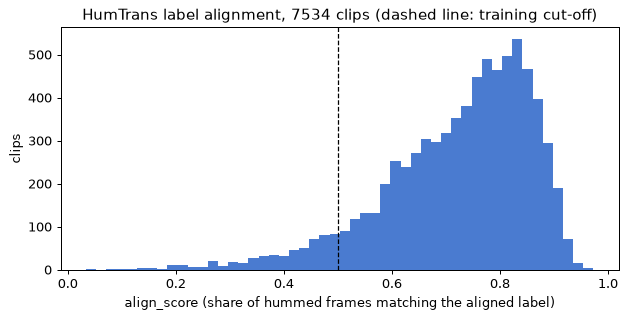

# Hyrule Warriors: Human Humming to Musical Note Transcription
## Introduction
Our team aims to create a deep learning model that can take human humming as an input and transcribe it into notes. We were inspired by the new <i>The Legend of Zelda: Ocarina of Time</i> game which includes a feature allowing the player to hum the notes of a song to activate a certain mechanic: <https://youtu.be/PQvD3p2yGwc?si=BmR2eiGZjW1xTqee&t=793>

We want to make a model that can be used in a similar way so that a user can hum into their microphone and have a transcribed series of notes instantaneously.

A plain-language walkthrough of every step so far is in [`StepsCompleted.txt`](StepsCompleted.txt).

## Project status
- [x] Data collection scripts for HumTrans and MIR-QBSH
- [x] Python environment (`requirements.txt`)
- [x] Checked whether HumTrans labels line up with the audio (they need a per-clip octave and lag fix, see [Frame labels](#frame-labels))
- [x] Automated tests (`tests/`)
- [x] Shared feature settings (`features.py`) and a faster, resumable feature script
- [x] Frame labels (`build_labels.py`)
- [x] Train / validation / test split (`splits.py`)
- [x] pYIN baseline and shared scoring (`baseline_pyin.py`, `evaluation.py`)
- [x] PyTorch dataset, CNN + Bi-LSTM model, decoder, training and evaluation
- [x] Synthetic hums (`generate_synthetic.py`)
- [x] Transcription demo from a WAV file or the microphone (`transcribe.py`)
- [ ] MIR-QBSH: code is ready, but the zip has to be copied into `raw_data/MIR-QBSH/` (the public download link is dead)

## Pipeline
Run the scripts from the project folder in this order:

| Step | Command | Output |
|---|---|---|
| 1. MIDI notes | `python collect_HumTrans_midi.py` | `processed_data/HumTrans/midi_notes.csv` |
| 2. Audio features | `python collect_HumTrans_wav.py --splits valid test train --train-limit 6000` | `processed_data/HumTrans/features/<clip>.npz` |
| 3. Frame labels | `python build_labels.py` | `processed_data/HumTrans/labels/<clip>.npz`, `alignment.csv` |
| 4. Check the split | `python splits.py --min-align-score 0.5` | clip counts (nothing written) |
| 5. Baseline | `python baseline_pyin.py` | `results/baseline_pyin_test.csv` / `.json` |
| 6. Synthetic hums (optional) | `python generate_synthetic.py --n 2000` | `processed_data/Synthetic/` |
| 7. MIR-QBSH (optional) | `python collect_MIR_QBSH_wav.py` then `python build_MIR_QBSH_labels.py` | `processed_data/MIR-QBSH/` |
| 8. Train | `python train.py --extra synthetic` | `checkpoints/model_best.pt`, `results/model_training_log.csv` |
| 9. Test | `python evaluate_model.py` | `results/model_test.csv` / `.json` |
| 10. Transcribe a hum | `python transcribe.py my_hum.wav` or `python transcribe.py --mic 8` | a `.mid` file |

To run the tests (a few seconds, no downloads needed):
```
python -m pytest tests
```

## Required dependencies
All packages are listed in `requirements.txt`. Install them into a virtual environment from the project folder:
```
python3 -m venv .venv
source .venv/bin/activate
pip install -r requirements.txt
```

* huggingface_hub, remotezip (downloading HumTrans)
* pretty_midi (reading and writing MIDI files)
* librosa (CQT features and pYIN pitch tracking)
* numpy, scipy, matplotlib (math and plots)
* torch (the model)
* mir_eval (scoring transcriptions)
* sounddevice (microphone recording for the demo)
* pytest (tests)


## Data Collection


### HumTrans
In `./raw_data/HumTrans/test/` is `extraction.ipynb`. This is a sample notebook that shows the process of downloading humming `.wav` files and their associated MIDI files. There are also two example files `one_hum.wav` and `one_midi.mid`.

`collect_HumTrans_midi.py` converts the MIDI files stored in `raw_data/HumTrans/all_midi.zip` into a CSV which splits up each individual note of the song and stores the file it is from, the pitch, the pitch name (what note it is), the onset, and the duration.

`collect_HumTrans_wav.py` streams the humming recordings from Hugging Face one at a time (the full 14.7 GB zip is never downloaded) and saves features to `processed_data/HumTrans/features/<clip>.npz`. You choose which splits to process and how many training clips to keep, it runs several clips in parallel, it stops at a size limit (`--max-gb`, default 5), and re-running it skips clips already saved, so an interrupted run can be resumed.

HumTrans has 14,614 clips from 10 singers (F01-F05, M01-M05). Files are named `personID_musicID_segmentID_repetitionID`, sometimes followed by `_U`, `_D`, `_DD` or `_DDD`, e.g. `F04_0055_0001_2_DD`. The dataset is licensed CC BY-NC 4.0 (non-commercial use only).

### Features (`features.py`)
Every script computes features through `features.py`, so they always match. Each feature file holds:

* `cqt_log_magnitude`: a CQT with **3 bins per semitone** from C2 (MIDI 36) up to C7, 180 bins, 100 frames per second, stored as float16 to save space. Three bins per semitone let the model see hummed notes that fall between two piano keys.
* `pyin_midi`: the pYIN pitch track (MIDI number per frame, NaN when silent). Only used to align the labels; the model never sees it.
* `metadata_json`: the settings used. Loading a file made with different settings raises an error instead of silently giving the model the wrong input.

About 0.45 MB per clip. On our machine the current subset (all validation and test clips plus 6,000 random training clips) is about 3.5 GB and took a few hours, mostly pYIN.

### MIR-QBSH
This is a zip file (`raw_data/MIR-QBSH/MIR-QBSH.zip`) containing human singing and the MIDI files associated with them. There are roughly 50 songs used in this data set and a handful of people singing the songs. `collect_MIR_QBSH_midi.py` turns the MIDI files into a note CSV, and `collect_MIR_QBSH_wav.py` saves features (same format as HumTrans) to `processed_data/MIR-QBSH/features/<year>_<person>_<song>.npz`.

The zip file is not in the repo to save space. The old download link (<http://mirlab.org/dataset/public/>) no longer works, and we could not find a mirror. A teammate has a copy (`processed_data/MIR-QBSH/midi_notes.csv` was made from it), so copy it into `raw_data/MIR-QBSH/`.

The MIR-QBSH MIDI files are the original song melodies, not transcriptions of each recording: people sang in their own key and tempo. So `build_MIR_QBSH_labels.py` makes labels from the `.pv` pitch-vector files instead (one pitch value per 32 ms of the recording, 0 = silence). It also compares every `.pv` with the pYIN track and saves the agreement as `align_score`, and prints a summary, so we can confirm the `.pv` files really match the audio. Note starts can only be guessed from `.pv` files, so training ignores MIR-QBSH onset labels. **Not yet run**: the zip is not on the training machine.

### Synthetic hums
In `./raw_data/Librosa/test/` is `librosa_hum_demo.ipynb`, a demo program showcasing how we can use NumPy and SciPy to generate audio waves. `generate_synthetic.py` builds on it to make training clips with **perfectly known labels**: random melodies (mostly small steps, with rests and repeated notes), low and high voices (sometimes with a weak fundamental, like the hardest real recordings), vibrato, slow pitch drift, glides between notes, a low-pass "hum" filter, background noise and random loudness. Use them with `python train.py --extra synthetic`.


## Frame labels
The model predicts one output per CQT frame (100 frames per second), so the MIDI notes have to be turned into per-frame labels. `build_labels.py` does this for every `.npz` in `processed_data/HumTrans/features/` and saves the labels to `processed_data/HumTrans/labels/<clip>.npz`:

* `pitch`: MIDI note number for each frame (0 = silence)
* `onset` / `offset`: 1 on the frame where a note starts / ends
* `octave_shift`, `lag_s`, `align_score`: the alignment used for this clip (see below)

It also writes `processed_data/HumTrans/alignment.csv`, one row per clip.

### Why the labels need aligning
We tracked the hummed pitch with pYIN on 30 clips (3 per singer), compared it with the MIDI, and found two problems:

* **Octave:** female singers hum at the MIDI octave, but male singers are usually 12 semitones lower, and sometimes 0, +12 or even -24. The `_D`/`_DD` file name suffix does not tell you which.
* **Lag:** singers start each note late by a fixed amount per clip, usually 40-250 ms but up to ~1.2 s for singers F02 and M02. It does not drift within a clip.

### How `build_labels.py` aligns them
For each clip it tries every octave shift (-24, -12, 0, +12) together with every lag from -0.2 s to 2 s, and keeps the combination that puts the most hummed frames within half a semitone of the label. That fraction is saved as `align_score` (out of all hummed frames in the clip, so a lag that leaves only a sliver of overlap cannot score well), after removing the singer's constant tuning offset (see below).

The hummed pitch comes from the pYIN track saved with the features. An earlier version read the pitch from the CQT instead, but for low male voices whose fundamental is faint it locked onto the overtone an octave up and chose the wrong octave (e.g. M01_0448). pYIN fixed those cases.

To check a clip by eye:
```
python build_labels.py --plot F02_0228_0002_1_D
```


The cyan line is the aligned label drawn over the CQT. This clip needed a 0.62 s lag correction.

### Results on 7,534 clips (all validation and test clips, 6,000 training clips)


* **Octave shift:** 0 for 4,261 clips, -12 for 3,106, -24 for 91 and +12 for 76.
* **Lag:** median 0.18 s; 90% of clips between 0.05 s and 1.0 s.
* **Tuning:** many singers hum slightly flat or sharp throughout (M02 is about 0.4 semitone flat). An earlier version of the score did not allow for this and rejected clips whose labels were fine, so the score now removes each clip's constant tuning offset first (saved as `tuning`). The labels themselves stay whole semitones.
* **Cut-off: 0.5.** 92.7% of clips score at least 0.5. Every singer keeps at least 84% of their clips except M03 (46%), whose very low voice pYIN often loses track of; the M03 clips we inspected had mostly correct labels, so this cut-off is cautious for that singer. After the cut-off: 5,546 train, 709 validation and 731 test clips.

| Singer | F01 | F02 | F03 | F04 | F05 | M01 | M02 | M03 | M04 | M05 |
|---|---|---|---|---|---|---|---|---|---|---|
| Median score | 0.81 | 0.82 | 0.87 | 0.83 | 0.77 | 0.72 | 0.61 | 0.49 | 0.70 | 0.66 |
| Kept at 0.5 | 100% | 100% | 100% | 100% | 99% | 99% | 84% | 46% | 99% | 93% |

## Train / validation / test split
`splits.py` uses the official HumTrans split (`raw_data/HumTrans/train_valid_test_keys.json`, downloaded from the [HumTrans Hugging Face page](https://huggingface.co/datasets/dadinghh2/HumTrans)): 13080 train, 765 validation and 769 test clips. It is split by **song**, so no song appears in more than one split, but every singer appears in all three. This means test scores show how well the model handles melodies it has never heard, not new voices.

```
python splits.py                        # clip counts per split
python splits.py --min-align-score 0.5  # counts after dropping poorly aligned clips
```
In code: `splits.get_split("train", min_align_score=0.5)` returns the clip names.

## Scoring (`evaluation.py`)
The baseline and the model are scored by the same code, against the same reference: each clip's MIDI notes moved by that clip's octave shift and lag. Scores use [mir_eval](https://craffel.github.io/mir_eval/):

| Metric | Meaning |
|---|---|
| COn F1 | note start within 50 ms |
| COnP F1 | note start within 50 ms **and** correct pitch (within 50 cents). Our main score. |
| COnPOff F1 | as COnP, and the note end is also close |
| frame_acc | fraction of labelled frames with exactly the right MIDI pitch |

F1 combines "how many of the real notes did we find" and "how many of the notes we output were real" into one number from 0 to 1.

## Baseline
`baseline_pyin.py` is a transcriber with no deep learning. It takes the pYIN pitch track saved with the features, rounds each frame to the nearest semitone, smooths it, and groups runs of the same note (at least 60 ms long) into notes. It runs offline on every labelled test clip.

Caveat: the labels are aligned using this same pYIN track, which may flatter the baseline slightly.

Results (`python baseline_pyin.py`):

| Metric | Test, all 769 clips | Test, 731 clips scoring >= 0.5 | Validation, all 765 clips |
|---|---|---|---|
| COn F1 | 0.578 | 0.588 | 0.610 |
| COnP F1 | 0.413 | 0.427 | 0.425 |
| COnPOff F1 | 0.270 | 0.282 | 0.307 |
| frame_acc | 0.688 | 0.705 | 0.682 |

Per-clip results are saved to `results/baseline_pyin_test.csv` and `results/baseline_pyin_valid.csv`. (An earlier version of these numbers, on 100 test clips with the older alignment, was COnP F1 0.368; the numbers above replace it.)

## The model


* **`dataset.py`** cuts each clip into random 3-second windows and pairs every frame with its labels. Pitch is one of 50 classes: silence, or one of the 49 notes from C2 to C6 (MIDI 36-84). Note-start labels are widened to one frame either side, since a single 10 ms frame is too strict a target. Short clips are padded and the padding is ignored by the loss. Datasets without reliable note starts (MIR-QBSH) have their onset labels ignored.
* **`model.py`** (`HumTranscriber`): a 3-layer CNN reads the CQT and learns local patterns such as a note's harmonics, shrinking 180 frequency bins to 20. A bidirectional LSTM then reads the whole sequence forwards and backwards. Two outputs per frame: which note is sounding (or silence), and the probability that a new note starts there. About 0.76 million parameters.
* **Loss:** cross-entropy for the pitch plus weighted binary cross-entropy for note starts (they are rare, so each one counts 5 times).
* **`decoding.py`** turns the frame predictions into notes. A note starts where the predicted pitch changes or where the model is confident a new note begins on the same pitch (a repeated note), and ends at the next silence, change or note start. Notes under 60 ms are dropped. It also writes MIDI files.

## Training
```
python train.py --overfit 50                 # sanity check: can it memorize 50 clips?
python train.py --extra synthetic --name model
python evaluate_model.py --checkpoint checkpoints/model_best.pt
```
`train.py` trains on clips with `align_score >= 0.5` (change with `--min-align-score`), scores 200 validation clips after every epoch with the same scoring as the baseline, keeps the checkpoint with the best validation COnP F1, halves the learning rate when progress stalls, and stops early after 8 epochs without improvement. It uses the Apple GPU (MPS) or CUDA when available. The per-epoch log goes to `results/<name>_training_log.csv`.

### Results
The run behind `checkpoints/model_best.pt` (`python train.py --extra synthetic --name model`): 5,546 HumTrans training clips plus 2,000 synthetic hums, 40 epochs of about 90 s each on an Apple M3 (MPS). Validation COnP F1 rose from 0.66 after epoch 1 to 0.77 after 10, levelled off after about 30, and peaked at 0.805 in epoch 36, which is the saved checkpoint. Full log: `results/model_training_log.csv`.

Test split (`python evaluate_model.py`), same scoring as the baseline:

| Metric | Model, all 769 clips | Baseline, all 769 clips | Model, 731 clips scoring >= 0.5 | Baseline, same clips |
|---|---|---|---|---|
| COn F1 | **0.787** | 0.578 | 0.801 | 0.588 |
| COnP F1 | **0.747** | 0.413 | 0.767 | 0.427 |
| COnPOff F1 | **0.663** | 0.270 | 0.684 | 0.282 |
| frame_acc | **0.872** | 0.688 | 0.887 | 0.705 |

The model beats the baseline on 99% of test clips. COnP F1 by singer (model / baseline):

| F01 | F02 | F03 | F04 | F05 | M01 | M02 | M03 | M04 | M05 |
|---|---|---|---|---|---|---|---|---|---|
| 0.82 / 0.50 | 0.81 / 0.54 | 0.85 / 0.61 | 0.92 / 0.55 | 0.81 / 0.44 | 0.80 / 0.41 | 0.57 / 0.23 | 0.45 / 0.16 | 0.73 / 0.35 | 0.69 / 0.34 |

M02 (sings flat) and M03 (very low voice) remain the hardest, matching where label alignment was weakest. Per-clip results: `results/model_test.csv`.

Not yet measured: accuracy on our own microphone recordings, and how much the synthetic hums contribute (no run without them yet).

## Transcription process


```
python transcribe.py my_hum.wav     # writes my_hum.mid
python transcribe.py --mic 8        # record 8 seconds from the microphone, writes hum.mid
```
`transcribe.py` follows the diagram: it trims silence from both ends, computes the CQT, runs the model, decodes the notes, prints them (e.g. `0.52-1.01 s  C4`) and writes a MIDI file. Because the Bi-LSTM reads the recording in both directions, the notes appear once the recording ends, not while you hum. Truly live output would need a model that only looks backwards in time.

## Tests
`tests/` holds automated tests (pytest) for every step. They build small synthetic inputs, so they need no downloads and run in a few seconds. Among other things they check that:

* notes become the right frame labels, and octave shifts and lags move them correctly
* the alignment search recovers a known octave shift and lag
* the CQT and pYIN trackers find the pitch of a synthesized hum
* no clip or song appears in two splits
* features and labels stay paired in training windows, and padding is ignored
* the model's outputs have the right shapes and a training step lowers the loss
* decoding perfect predictions gives back the original notes, and MIDI files contain them
* synthetic hums line up with their labels with no shift or lag
* the transcription demo runs end to end, and silence gives no notes
